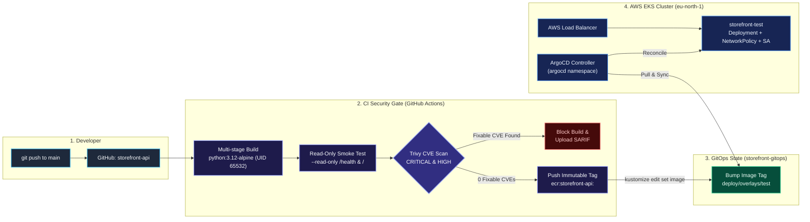

# Storefront Platform — DevSecOps & GitOps Reference Architecture


Here we have our Kubernetes platform deployment for a containerized FastAPI microservice (`storefront-api`) on AWS EKS, built with Infrastructure as Code (Terraform), Kustomize multi-environment overlays, automated Trivy vulnerability gating (GitHub Actions), and pull-based GitOps continuous delivery (ArgoCD).

## 1. Architecture & CI/CD Flow

We enforce two-repository seperation of concerns, decided as part of our repository strategy:

* **Application Repository ([`Bsalarian/storefront-api`](https://github.com/Bsalarian/storefront-api)):** Contains FastAPI source code, multi-stage `Dockerfile`, and CI (Continuous Integration) workflows. Holds zero Kubernetes cluster credentials.
* **GitOps Configuration Repository ([`Bsalarian/storefront-gitops`](https://github.com/Bsalarian/storefront-gitops)):** Single source of truth for desired cluster state. ArgoCD continuously reconciles the EKS cluster against `main`, automatically reverting configuration drift (`selfHeal: true`).


## 2. Repository Structure
```text
storefront-gitops/
├── argocd/
│   ├── application-test.yaml           # Automated sync & self-heal for test
│   └── application-prod.yaml           # Manual sync gate for production promotion
├── deploy/
│   ├── base/                           # Shared hardened Kubernetes manifests
│   │   ├── configmap.yaml
│   │   ├── deployment.yaml
│   │   ├── ingress.yaml
│   │   ├── kustomization.yaml
│   │   ├── networkpolicy.yaml
│   │   ├── service.yaml
│   │   └── serviceaccount.yaml
│   ├── observability/
│   │   └── servicemonitor.yaml         # Prometheus scrape config (/metrics, 15s)
│   ├── overlays/
│   │   ├── production/                 # 3 replicas, HPA (3–6), PDB, higher quotas
│   │   │   ├── hpa.yaml
│   │   │   ├── kustomization.yaml
│   │   │   ├── namespace.yaml
│   │   │   └── patch-deployment.yaml
│   │   └── test/                       # 1 replica, DEBUG logs, LoadBalancer, CI-bumped
│   │       ├── kustomization.yaml
│   │       └── namespace.yaml
│   └── secrets/
│       └── externalsecret.yaml         # External Secrets Operator reference (mock store)
├── terraform/
│   └── main.tf                         # VPC, EKS control plane, managed nodes, Pod Identity
├── Makefile                            # Single-command cluster lifecycle & demo helpers
└── README.md
```

---

## 3. Running the Demo on AWS EKS

### Prerequisites
* **AWS CLI (Command Line Interface)** configured for `eu-north-1` on an account without Service Control Policies blocking EC2 (Elastic Compute Cloud) or Elastic Load Balancing.
* **Terraform** (`>= 1.5`), **`kubectl`**, and optionally **`gh` (GitHub CLI)** installed locally.
* **GitHub Secrets** set in `storefront-api`: `AWS_ACCESS_KEY_ID`, `AWS_SECRET_ACCESS_KEY`, and `GITOPS_PAT` (write access to `storefront-gitops`).

### Cluster Bootstrap & Teardown

1. **Provision EKS, install pinned ArgoCD (`v2.13.3`), and register the app:**
   ```bash
   git clone [https://github.com/Bsalarian/storefront-gitops.git](https://github.com/Bsalarian/storefront-gitops.git)
   cd storefront-gitops
   make up
   ```
   *Provisions the VPC (Virtual Private Cloud), EKS cluster, managed node group, `vpc-cni` (with NetworkPolicy enforcement enabled), `eks-pod-identity-agent`, and immutable ECR (Elastic Container Registry) repository via Terraform; installs ArgoCD `v2.13.3` via server-side apply; applies `argocd/application-test.yaml`; and triggers the initial `storefront-api` CI build.*

2. **Check sync status and retrieve the public demo URL:**
   ```bash
   make status   # Wait until SYNC STATUS = Synced and HEALTH STATUS = Healthy
   make url      # Prints live http://<elb-hostname>[.eu-north-1.elb.amazonaws.com/](https://.eu-north-1.elb.amazonaws.com/) links
   ```

3. **Inspect the ArgoCD Web UI (Optional):**
   ```bash
   kubectl -n argocd get secret argocd-initial-admin-secret -o jsonpath="{.data.password}" | base64 -d && echo
   kubectl port-forward svc/argocd-server -n argocd 8443:443
   ```
   Open `https://localhost:8443` (`admin` + printed password) to view the live resource dependency tree.

4. **Tear down AWS resources when done:**
   ```bash
   make down
   ```
   *Deletes Kubernetes namespaces first so AWS cleanly releases the Load Balancer and security groups, then runs `terraform destroy -auto-approve` (including `force_delete = true` on ECR) so idle AWS billing stops immediately.*

   Please do destroy after testing since it costs money :) 

---

## 4. Security Decisions & Trade-offs

| Area | Implementation | Trade-off & Rationale |
| :--- | :--- | :--- |
| **Base Image & Trivy Gate** | Multi-stage `python:3.12-alpine` (`apk upgrade --no-cache`, `pip`/`setuptools`/`wheel` removed) + Trivy failing on `CRITICAL,HIGH` (`--ignore-unfixed`) | **Trade-off:** `--ignore-unfixed` permits upstream flaws without vendor patches yet, and Alpine uses `musl` libc instead of `glibc`.<br>**Rationale:** Originally used `distroless/python3-debian12`, but Trivy flagged 45 unpatchable `HIGH` Debian OS CVEs (`libexpat1`, `libssl3`). Switching to patched Alpine reduced fixable `HIGH`/`CRITICAL` CVEs to **0** (~25 MB image). |
| **Pod Hardening** | `runAsNonRoot: true`, `UID 65532`, `readOnlyRootFilesystem: true`, `allowPrivilegeEscalation: false`, `capabilities.drop: ["ALL"]`, `seccompProfile: RuntimeDefault`, and namespace `pod-security.kubernetes.io/enforce: restricted` | **Trade-off:** App cannot write temporary files or `.pyc` bytecode caches (`PYTHONDONTWRITEBYTECODE=1` set).<br>**Rationale:** Blocks root privilege escalation, Linux capability abuse, and runtime filesystem tampering. |
| **Identity & RBAC** | Dedicated `ServiceAccount` (`automountServiceAccountToken: false`), minimal namespace `Role`, and **EKS Pod Identity** (`eks-pod-identity-agent` add-on installed) | **Trade-off:** Pods cannot query the Kubernetes API unless a projected token is explicitly mounted, and no `aws_eks_pod_identity_association` is bound yet since the demo app is stateless.<br>**Rationale:** Prevents token theft if the app is compromised and avoids legacy IRSA OIDC thumbprint management. |
| **Network Policy** | Default-deny ingress (TCP `8080` only) and restricted egress (DNS UDP/TCP `53` and HTTPS TCP `443`), enforced via `vpc-cni` `enableNetworkPolicy: "true"` | **Trade-off:** New consumers or outbound dependencies require explicit policy rules.<br>**Rationale:** Blocks lateral east-west movement and unauthorized outbound traffic. |
| **Secrets** | External Secrets Operator reference (`deploy/secrets/externalsecret.yaml`) using `provider.fake` | **Trade-off:** Unapplied reference manifest; ESO is not installed by `make up` to avoid controller overhead on a stateless demo.<br>**Rationale:** Keeps secrets out of Git while enabling a 5-line switch to `provider.aws` in production. |
| **Load Balancing & Prod Overlay** | `Service` patched to `type: LoadBalancer` (Classic ELB) in `test`; `production` overlay pins placeholder `v1.0.0` | **Trade-off:** Classic ELB lacks Layer-7 routing/WAF, and syncing `production` requires promoting a `v1.0.0` tag to ECR.<br>**Rationale:** Exposes a public demo URL without installing the AWS Load Balancer Controller add-on, while keeping `deploy/base/ingress.yaml` and `production` HPA/PDB manifests ready. |

---

## 5. Observability Strategy (Application & Infrastructure)

The API exposes Prometheus metrics at `/metrics` via `prometheus-client`, paired with a `ServiceMonitor` (`deploy/observability/servicemonitor.yaml`) configured for 15-second scrapes.

### Application Metrics (RED Method)
* **Rate:** `sum(rate(http_requests_total[5m])) by (endpoint)`
* **Errors:** `sum(rate(http_requests_total{status=~"5.."}[5m])) / sum(rate(http_requests_total[5m]))`
* **Duration:** `histogram_quantile(0.99, sum(rate(http_request_duration_seconds_bucket[5m])) by (le, endpoint))`


## 6. Day 2 Operations & Incident Runbook

* **Declarative Rollback:** Identify the last healthy commit (`git log -n 5 --oneline`), run `git revert <bad-commit-sha> && git push`, and let ArgoCD roll the Deployment back to the previous immutable ECR SHA tag automatically.
* **ArgoCD `ComparisonError`:** Run `kubectl describe application storefront-api-test -n argocd` to inspect Kustomize rendering or Kubernetes schema errors.
* **`CrashLoopBackOff` under `readOnlyRootFilesystem`:** Check `kubectl logs -n storefront-test -l app=storefront-api` and mount an `emptyDir` volume at `/tmp` if scratch storage is required.
* **`ImagePullBackOff`:** Confirm the node IAM role includes `AmazonEC2ContainerRegistryReadOnly` and verify the SHA tag exists in ECR (`aws ecr describe-images --repository-name storefront-api`).
---

## 7. What I Would Add for Production

1. **GitHub Actions OIDC Federation:** Replace static `AWS_ACCESS_KEY_ID` / `AWS_SECRET_ACCESS_KEY` secrets with short-lived IAM roles assumed via GitHub OIDC.
2. **AWS Load Balancer Controller + ACM + WAF:** Provision an **ALB (Application Load Balancer)** from `deploy/base/ingress.yaml`, terminate HTTPS with ACM, and attach AWS WAF rules (OWASP Top 10 + rate limiting).
3. **Live AWS Secrets Manager + ESO:** Install External Secrets Operator via Terraform/Helm and switch `externalsecret.yaml` from `provider.fake` to `provider.aws.service: SecretsManager` backed by an `aws_eks_pod_identity_association`.
4. **Remote Terraform State:** Store `terraform.tfstate` in an encrypted S3 bucket with versioning and state locking instead of local disk.
5. **Image Signing & Admission Policy:** Sign images in CI with **Sigstore Cosign** and enforce signature verification at admission using **Kyverno** or **OPA Gatekeeper**.
6. **Full Observability & Canary Rollouts:** Deploy `kube-prometheus-stack` + OpenTelemetry collector for alerting, and use **Argo Rollouts** in `production` (`minReplicas: 3`, HPA + PDB already configured) for automated canary promotions.

---

## 8. Engineering Build Log (Implementation Timeline)

The thought process and how I went at the task, logged in the following steps:


0. **Read documentaion and plan**: Look at standard devsevops practices, understand the assignment and deliverables. Make a plan of attack and draw the architecture.
1. **Foundation & Container Hardening:** Set up AWS IAM user, ECR repository, and local tooling (`kubectl`, `terraform`, `k9s`). Built the FastAPI service (`/`, `/health`, `/metrics`) and verified `--read-only` local Docker execution.
2. **Infrastructure as Code (Terraform):** Provisioned a multi-AZ VPC, EKS control plane, managed node group, and `eks-pod-identity-agent` add-on with `.gitignore` configured to exclude local `.tfstate` files.
3. **Kustomize & GitOps Setup:** Built the hardened `base/` manifests and `test`/`production` overlays (`HPA`, `PDB`, resource quotas), configured GitHub Actions CI, and installed ArgoCD on EKS.
4. **Vulnerability Remediation (Distroless $\rightarrow$ Alpine):** Trivy flagged 45 unpatchable `HIGH` OS CVEs in `distroless/python3-debian12`. Migrated to patched `python:3.12-alpine` with build tools stripped, reducing fixable `HIGH`/`CRITICAL` CVEs to zero and enabling SARIF security reporting.
5. **Security & Networking Polish:** Added least-privilege `ServiceAccount` (`automountServiceAccountToken: false`), `Role`/`RoleBinding`, default-deny `NetworkPolicy`, `ConfigMap`, `ServiceMonitor`, mock `ExternalSecret`, and `Makefile` automation.
6. **Cloud Guardrails & Sync Debugging:** Resolved an AWS Organizations Service Control Policy blocking ELB creation by enabling full AWS Organization features, pushed the unpushed `ServiceAccount` manifest so ArgoCD could schedule the pod, and verified live traffic over the public Load Balancer URL.