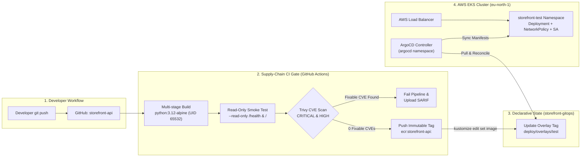

# Storefront Platform — DevSecOps & GitOps Reference Architecture


Here we have our production-grade Kubernetes platform deployment for a containerized FastAPI microservice (`storefront-api`) on AWS EKS, built with Infrastructure as Code (Terraform), Kustomize multi-environment overlays, automated Trivy vulnerability gating (GitHub Actions), and pull-based GitOps continuous delivery (ArgoCD).

## 1. Architecture & CI/CD Flow

We enforce two-repository seperation of concerns, decided as part of our repository strategy:

* **Application Repository:** [`Bsalarian/storefront-api`](https://github.com/Bsalarian/storefront-api): 

    Contains FastAPI source code, multi-stage `Dockerfile`, and CI workflows. It holds zero Kubernetes cluster credentials.
* **Infrastructure & GitOps Repository:** [`Bsalarian/storefront-gitops`](https://github.com/Bsalarian/storefront-gitops): 

    Acts as the single source of truth for desired cluster state. ArgoCD continuously reconciles the EKS cluster against `main`, automatically reverting 
    configuration drift (`selfHeal: true`).


## 2. Repository Structure

```
storefront-gitops/
├── argocd
│   ├── application-test.yaml               # Automated sync & self-heal for test 
│   └── application-prod.yaml               # Manual sync gate for production promotion
├── deploy
│   ├── base                                # Shared hardened Kubernetes manifests
│   │   ├── configmap.yaml
│   │   ├── deployment.yaml
│   │   ├── ingress.yaml
│   │   ├── kustomization.yaml
│   │   ├── networkpolicy.yaml
│   │   ├── service.yaml
│   │   └── serviceaccount.yaml
│   ├── observability
│   │   └── servicemonitor.yaml             # Prometheus scrape config (/metrics, 15s)
    |   
│   └── overlays
│       ├── production                      # 3 replicas, HPA (3–6), PDB, higher quotas
│       │   ├── hpa.yaml
│       │   ├── kustomization.yaml
│       │   ├── namespace.yaml
│       │   └── patch-deployment.yaml
│       └── test                            # 1 replica, DEBUG logging, LoadBalancer, CI-bumped
│           ├── kustomization.yaml
│           ├── namespace.yaml
│           └── patch-deployment.yaml
├── terraform
│   ├── main.tf                             # VPC, EKS control plane, managed node group, Pod Identity
│   ├── terraform.tfstate
│   └── terraform.tfstate.backup
├── Makefile                                # Single-command cluster lifecycle & demo automation
└── README.md
```

## 3. How to Run the Full Demo on a Cloud-Managed Cluster (AWS EKS)

### Prerequisites
* **AWS CLI (Command Line Interface)** configured for an AWS account (`eu-north-1` default) without organizational SCPs (Service Control Policies) blocking EC2 (Elastic Compute Cloud) or ELB (Elastic Load Balancing).
* **Terraform** (`>= 1.5`) and **`kubectl`** installed locally.
* **GitHub Secrets** configured in `storefront-api`: `AWS_ACCESS_KEY_ID`, `AWS_SECRET_ACCESS_KEY`, and `GITOPS_PAT` (Personal Access Token with write access to `storefront-gitops`).

### Step-by-Step Execution

1. **Provision EKS, install ArgoCD, and register the application:**
   ```bash
   git clone https://github.com/Bsalarian/storefront-gitops.git
   cd storefront-gitops
   make up
   ```
   *Runs `terraform apply` (VPC (Virtual Private Cloud), EKS control plane, managed node group, Pod Identity add-on, and ECR (Elastic Container Registry) repository), installs ArgoCD via server-side apply (`--server-side --force-conflicts`), and registers `argocd/application-test.yaml`.*

2. **Populate the initial container image in ECR:**
   Because `make down` destroys the Amazon ECR repository to eliminate idle storage costs, a fresh `make up` starts with an empty registry. Trigger the CI workflow in `storefront-api` (**Actions -> Run workflow** or push an empty commit) so GitHub Actions builds, scans, and pushes the initial `:<git-sha>` image tag and updates `deploy/overlays/test/kustomization.yaml`.

3. **Verify sync status and retrieve the public demo URL:**
   ```bash
   make status   # Wait until SYNC STATUS = Synced and HEALTH STATUS = Healthy
   make url      # Prints clickable http://<elb-hostname>.eu-north-1.elb.amazonaws.com/ links
   ```

4. **Inspect the ArgoCD Web UI (Optional):**
   ```bash
   kubectl -n argocd get secret argocd-initial-admin-secret -o jsonpath="{.data.password}" | base64 -d && echo
   kubectl port-forward svc/argocd-server -n argocd 8443:443
   ```
   Open `https://localhost:8443` (`admin` + printed password) to inspect the live resource dependency tree.

5. **Tear down all AWS resources when finished:**
   ```bash
   make down
   ```
   *Deletes Kubernetes namespaces first so AWS cleanly releases the Load Balancer and security groups, then executes `terraform destroy -auto-approve`.*

   Please do, it costs money :) 

---

## 4. Security Decisions & Engineering Trade-offs

| Decision Area | Choice Implemented | Trade-off & Engineering Rationale |
| :--- | :--- | :--- |
| **Container Base Image** | Multi-stage `python:3.12-alpine` with `apk upgrade --no-cache` and package-manager removal (`pip uninstall pip setuptools wheel`) | **Trade-off:** Alpine uses `musl` libc instead of `glibc`, which can require compiling C-extension wheels from source.<br>**Rationale:** Initially evaluated `gcr.io/distroless/python3-debian12`, but Trivy flagged 45 unpatchable `HIGH` Debian OS CVEs (Common Vulnerabilities and Exposures) (`libexpat1`, `libssl3`). Switching to patched Alpine reduced fixable `HIGH`/`CRITICAL` CVEs to **0** while shrinking compressed image size to ~25 MB. |
| **Pod & Container Hardening** | `runAsNonRoot: true`, `runAsUser: 65532`, `readOnlyRootFilesystem: true`, `allowPrivilegeEscalation: false`, `capabilities.drop: ["ALL"]`, `seccompProfile: RuntimeDefault`, plus namespace-level `pod-security.kubernetes.io/enforce: restricted` | **Trade-off:** Application cannot write temporary files or bytecode caches (`PYTHONDONTWRITEBYTECODE=1` required).<br>**Rationale:** Prevents root privilege escalation, Linux capability abuse, and runtime filesystem tampering if the FastAPI process is compromised. |
| **ServiceAccount & IAM Auth** | Dedicated `ServiceAccount` with `automountServiceAccountToken: false`, minimal namespace `Role`, and **EKS Pod Identity** (`eks-pod-identity-agent`) | **Trade-off:** Pods cannot query the Kubernetes API (Application Programming Interface) unless a projected token is explicitly mounted.<br>**Rationale:** Prevents service account token theft via SSRF (Server-Side Request Forgery) / RCE (Remote Code Execution) vulnerabilities, and EKS Pod Identity eliminates legacy IRSA (IAM Roles for Service Accounts) OIDC (OpenID Connect) thumbprint management. |
| **Network Isolation** | Default-deny ingress `NetworkPolicy` permitting traffic only on TCP (Transmission Control Protocol) `8080` | **Trade-off:** Requires explicit ingress rules before adding sidecars or new consumers.<br>**Rationale:** Blocks lateral east-west movement from compromised pods in shared or adjacent namespaces. |
| **Secret Management** | External Secrets Operator (`SecretStore` + `ExternalSecret`) using a mock provider for zero-cost demo portability | **Trade-off:** Secrets are mocked in the sandbox demo rather than fetched from live AWS Secrets Manager.<br>**Rationale:** Decouples secret storage from Git while enabling a 5-line switch from `provider.fake` to `provider.aws` in production without modifying Deployment manifests. |
| **Public Exposure (Demo vs. Prod)** | `Service` patched to `type: LoadBalancer` (Classic ELB) in `test` overlay for zero-dependency demo access | **Trade-off:** Classic ELB lacks Layer-7 path routing and WAF (Web Application Firewall) integration.<br>**Rationale:** Avoids installing the AWS Load Balancer Controller add-on just to expose a single demo endpoint, while keeping an `Ingress` manifest ready in `deploy/base/`. |

---
## 5. Observability Strategy

The microservice is instrumented with `prometheus-client` at `/metrics` and includes a Prometheus Operator `ServiceMonitor` (`deploy/observability/servicemonitor.yaml`) configured for 15-second scrape intervals.

* **Currently Exposed Metrics (`/metrics`):**
  * **Request Throughput:** `app_requests_total{endpoint="..."}` counter tracking traffic per route (`rate(app_requests_total[5m])`).
  * **Process & Runtime Health:** `process_cpu_seconds_total`, `process_resident_memory_bytes`, `process_open_fds`, and Python GC collection counters to detect memory leaks or file descriptor exhaustion.
* **Architectural Decision :** A full `kube-prometheus-stack` (Prometheus + Grafana + Alertmanager) is omitted from the ephemeral demo cluster to keep worker node sizing minimal (`t3.small`/`t3.medium`), while keeping the `ServiceMonitor` manifest ready for immediate plug-in.
* **Production Observability Additions:** In production, I would instrument HTTP status codes and latency histograms (`http_request_duration_seconds_bucket`) via FastAPI middleware to alert on full **RED** SLOs (5xx error ratio > 1% and p99 latency > 250ms).

---

## 6. Day 2 Operations & Incident Runbook

### Declarative GitOps Rollback
Because cluster state is driven by `storefront-gitops`, rolling back a bad release requires **zero manual `kubectl edit` commands**:
1. Identify the last known-good commit: `git log -n 5 --oneline`
2. Revert the image tag bump commit: `git revert <bad-commit-sha> && git push`
3. ArgoCD detects the revert and rolls the Deployment back to the previous immutable ECR SHA (Secure Hash Algorithm) tag within 3 minutes (or immediately via `argocd app sync storefront-api-test`).

### Common Failure Diagnostics
* **ArgoCD `ComparisonError` / `OutOfSync`:** Run `kubectl describe application storefront-api-test -n argocd` to inspect Kustomize rendering errors or Kubernetes API schema rejections.
* **Pod `CrashLoopBackOff` under `readOnlyRootFilesystem`:** Check logs via `kubectl logs -n storefront-test -l app=storefront-api`. Verify `PYTHONDONTWRITEBYTECODE=1` is set and mount an `emptyDir` volume at `/tmp` if scratch storage is required.
* **Pod `ImagePullBackOff`:** Confirm the node IAM (Identity and Access Management) role includes `AmazonEC2ContainerRegistryReadOnly` and verify the SHA tag exists in ECR (`aws ecr describe-images --repository-name storefront-api`).

---

## 7. What I Would Add for a Production-Grade Setup

To promote this reference architecture from a cost-controlled demo to a multi-team production platform, I would add the following layers:

1. **GitHub Actions OIDC Federation (Eliminate Static AWS Keys):** Replace long-lived `AWS_ACCESS_KEY_ID` and `AWS_SECRET_ACCESS_KEY` GitHub secrets with an AWS IAM OIDC identity provider so CI workflows assume short-lived, repository-scoped IAM roles.
2. **AWS Load Balancer Controller + ACM TLS + WAF:** Install the AWS Load Balancer Controller via Helm/Terraform to provision an **ALB (Application Load Balancer)** from `deploy/base/ingress.yaml`, terminate HTTPS (Hypertext Transfer Protocol Secure) with an ACM (AWS Certificate Manager) certificate, and attach **AWS WAF** managed rule groups (OWASP (Open Worldwide Application Security Project) Top 10 + rate limiting).
3. **Live AWS Secrets Manager Integration:** Switch `deploy/secrets/externalsecret.yaml` from `provider.fake` to `provider.aws.service: SecretsManager` backed by an EKS Pod Identity IAM role with automated secret rotation.
4. **Remote Terraform State with Locking:** Migrate `terraform.tfstate` from local disk to an encrypted **S3 (Simple Storage Service) bucket** with versioning and state locking so multiple engineers cannot corrupt cluster state concurrently.
5. **Image Signing & Admission Enforcement:** Sign container images in CI with **Sigstore Cosign** and enforce signature verification at admission time using **Kyverno** or **OPA (Open Policy Agent) Gatekeeper**, blocking unsigned or `:latest` tags from scheduling on EKS.
6. **Full Observability Stack & Alerting:** Deploy `kube-prometheus-stack` (Prometheus, Grafana, Alertmanager) to scrape `deploy/observability/servicemonitor.yaml` and route PagerDuty/Slack alerts on 5xx error-rate burn and p99 latency SLO breaches.
7. **Progressive Delivery (Canary Rollouts):** Replace standard rolling updates in `production` with **Argo Rollouts** (`minReplicas: 3`, HPA + PDB (Pod Disruption Budget) already configured) to shift traffic incrementally (`10% -> 50% -> 100%`) with automated rollback on Prometheus error spikes.